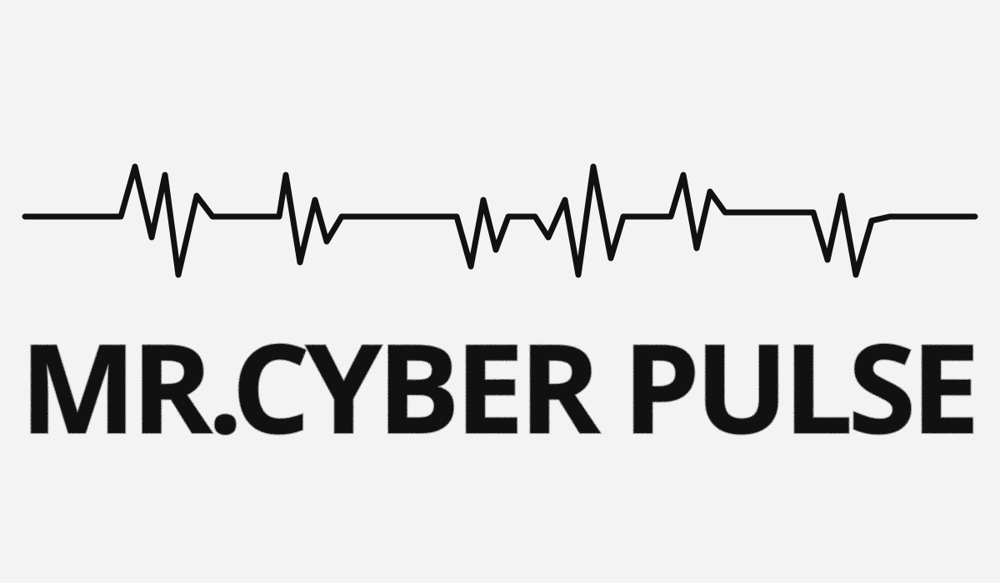

# IoT Hunter v2.1

<div align="center">
  
</div>

<p align="center">
  <strong>All-in-One IoT Security Toolkit</strong><br>
  Discovery, Credential Scanner, Firmware Analysis, Anomaly Detection, Protocol Analysis, Remediation, Reporting
</p>

<p align="center">
  <a href="https://github.com/mrcyberharsh/iot-hunter/stargazers"></a>
  <a href="https://github.com/mrcyberharsh/iot-hunter/issues"></a>
  <a href="https://github.com/mrcyberharsh/iot-hunter/blob/main/LICENSE"></a>
</p>

Built by MR CYBER (Harsh Saini)  
"Complex ko Simple. Simple ko Powerful."

## Overview

IoT Hunter is a defensive IoT security toolkit designed for ethical network discovery, device fingerprinting, credential testing, anomaly detection, protocol auditing, remediation guidance, and report generation.

It helps security researchers and defenders inspect networks they own or are explicitly authorized to test — with a strong emphasis on visibility, actionable findings, and low-friction local operation.

## Features

- ARP-based discovery for local subnet inventory
- TCP port scanning for common IoT service ports
- OUI/vendor lookup using `manuf` and local OUI database fallback
- Banner grabbing and device-type classification
- NVD-based CVE lookup tied to discovered service banners
- Async scanning for faster reconnaissance and validation
- Default credential checks using local wordlists
- Protocol auditing for insecure services and plaintext exposure
- Traffic anomaly detection with alerting
- PDF + JSON report generation
- GUI mode with Tkinter for easier scanning workflows

## Legal Disclaimer

Only scan networks and devices you own or are explicitly authorized to test.  
Unauthorized scanning of networks may be illegal in your jurisdiction. This tool prompts for confirmation before running scans.

## Quick Start

### 1) Install dependencies

```bash
pip install -r requirements.txt
```

### 2) Configure the scanner

Edit `config.yaml` to match your network and scanning preferences.

Common settings include:
- `interface` / `subnet` for discovery
- `wordlist_path` for default credential checks
- `thresholds` for anomaly sensitivity
- `report_path` for saved reports

### 3) Launch the CLI

```bash
python iothunter.py
```

### 4) Launch the GUI

```bash
python gui.py
```

## Installation Guide

### Linux

```bash
sudo apt update
sudo apt install -y python3 python3-pip python3-dev libpcap-dev
pip install -r requirements.txt
```

If you are scanning with raw sockets or ARP, run the scanner with elevated permissions:

```bash
sudo python3 iothunter.py
```

### Windows

1. Install Python 3.10+ from python.org
2. Install Npcap with WinPcap-compatible mode enabled
3. Open PowerShell or Command Prompt as Administrator
4. Run:

```powershell
pip install -r requirements.txt
python .\iothunter.py
```

### macOS

```bash
brew install python libpcap
pip install -r requirements.txt
sudo python3 iothunter.py
```

## Usage Modes

The CLI presents a menu with these modes:

1. Full Scan  
   discovery → fingerprint → credential checks → protocol scan → anomaly monitoring → report generation
2. Discovery Only  
   ARP + port scan + vendor lookup
3. Protocol Scan Only  
   live insecure protocol detection
4. Anomaly Monitor Only  
   packet-based behavior checks
5. Exit

## Repository Structure

```text
iot-hunter/
├── gui.py
├── iothunter.py
├── config.yaml
├── requirements.txt
├── README.md
├── LICENSE
├── modules/
│   ├── anomaly.py
│   ├── credentials.py
│   ├── discovery.py
│   ├── fingerprint.py
│   ├── protocol.py
│   ├── remediation.py
│   ├── reporting.py
│   └── data/
├── reports/
├── logs/
└── robots.txt
```

## Module Overview

- `discovery.py` — ARP scanning, port scanning, OUI vendor lookup
- `fingerprint.py` — banner grabbing, service parsing, device classification, CVE enrichment
- `credentials.py` — rate-limited default credential checks
- `anomaly.py` — packet capture and anomaly monitoring
- `protocol.py` — insecure protocol detection
- `remediation.py` — mitigation guidance and commands
- `reporting.py` — PDF and JSON output generation

## How the CVE Check Works

For discovered services and banners, IoT Hunter attempts to:

1. Read the banner from the open port
2. Identify a likely service name and version
3. Query the NVD API using the service/version as a keyword search
4. Display matching CVEs in the scan output and report

This provides a lightweight companion to full vulnerability assessment workflows and is intended for local, ethical use.

## Notes

- ARP scanning and packet capture require elevated privileges (root/Administrator).
- No hardcoded IPs or simulated data are used in the live scan workflow.
- Reports are generated locally inside the `reports/` directory.
- For best results, use this tool only on networks you own or are explicitly authorized to assess.

## Support & Contribution

If you find this tool useful, consider:

- starring the repository
- reporting a bug through GitHub Issues
- contributing via pull requests
- sharing it with the security community

## Author

Harsh Saini (MR CYBER)  
GRC & Defensive Cybersecurity Learner

- Website: https://mrcyberharsh.github.io
- GitHub: https://github.com/mrcyberharsh
- LinkedIn: https://linkedin.com/in/mrcyberharsh
- Email: manager.prachi@zohomail.in

## License

This project is licensed under the GNU General Public License v3.0 (GPL-3.0).  
See the `LICENSE` file for details.

---

Built with love by MR Cyber Pulse  
Complex ko Simple. Simple ko Powerful.


