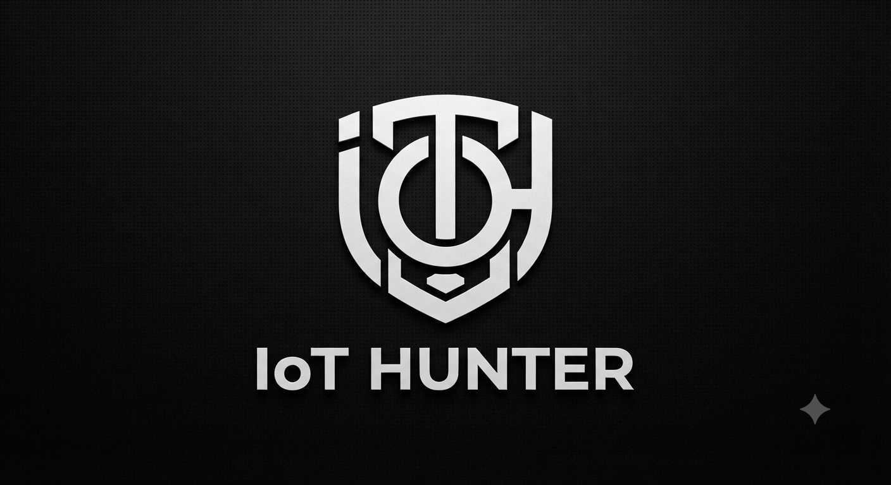

<div align="center">



<br />

#  IoT Hunter

**Next-Gen Defensive IoT Security & Network Reconnaissance Toolkit**

[](https://github.com/mrcyberharsh/iot-hunter)
[](https://www.python.org/)
[](LICENSE)
[](https://github.com/mrcyberharsh/iot-hunter/stargazers)
[](https://github.com/mrcyberharsh/iot-hunter/issues)
[](https://github.com/mrcyberharsh/iot-hunter/pulls)

[Features](#-core-capabilities) • [Quick Start](#-quick-start) • [v4 Web Dashboard](#-v40-web-dashboard-preview) • [Architecture](#-architecture) • [Safety](#-safety--authorization)

</div>

---

> ** Security Notice:** IoT Hunter is strictly a **defensive auditing tool** for networks you own or have explicit written authorization to assess. Findings represent *leads for review*, not proof of exploitability.

## ⚡ Core Capabilities

| Module | Capability | Description |
| :--- | :--- | :--- |
|  **Discovery** | Active ARP & Subnet Scan | Rapidly inventories live hosts on private IPv4 segments (`/24` max). |
|  **Fingerprinting** | Service, Banner & OUI | Identifies hardware vendors via MAC OUI and extracts service banners. |
|  **Vuln Lookup** | CVE Intelligence | Maps detected services and versions against known CVE advisories. |
|  **TLS Hygiene** **(Planned)**| Certificate & Cipher Audit | Flags expired, self-signed, or weak-cipher TLS endpoints. |
|  **Protocol Audit** | IoT Traffic Inspection | Reviews configurations across common IoT communication protocols. |
|  **Drift Tracking** | Snapshot History | Tracks new, missing, and modified devices across the last 50 scans. |
|  **Reporting** | Automated Exports | Generates clean PDF and JSON audit reports with remediation guidance. |

---

##  Quick Start

### 1. Clone & Setup

```bash
git clone https://github.com/mrcyberharsh/iot-hunter.git
cd iot-hunter
python3 -m pip install --upgrade pip
python3 -m pip install -r requirements-dev.txt
PYTHONPATH=backend python -m pytest -q tests
```

> ℹ️ **Testing note:** the suite runs under **pytest** (`tests/` contains pytest-style tests). If you previously followed docs suggesting `unittest discover`, use the command above instead.

### 2. Platform Prerequisites

<details>
<summary><b>🐧 Linux (Debian / Ubuntu)</b></summary>
<br>

```bash
sudo apt update
sudo apt install -y python3 python3-pip python3-dev python3-tk libpcap-dev
sudo env PYTHONPATH=backend python3 backend/iothunter.py
```
</details>

<details>
<summary><b> Windows (Requires Npcap + Admin)</b></summary>
<br>

1. Install **Python 3.10+** (check *"Add python.exe to PATH"*).
2. Install **[Npcap](https://npcap.com/#download)** with **"WinPcap API-compatible Mode"** enabled.
3. Open **PowerShell as Administrator** and run:
```powershell
python backend/iothunter.py
```
</details>

<details>
<summary><b>🍎 macOS (Homebrew)</b></summary>
<br>

```bash
brew install python libpcap
sudo env PYTHONPATH=backend python3 backend/iothunter.py
```
</details>

### 3. Launch Modes

```bash
# Interactive CLI Scanner
sudo env PYTHONPATH=backend python3 backend/iothunter.py

# Desktop GUI (Tkinter)
sudo python3 backend/gui.py
```

<details>
<summary><b>📟 View Sample CLI Output</b></summary>
<br>

```text
DISCLAIMER: Only scan networks and devices you own or are
explicitly authorized to test. Unauthorized scanning may be illegal.
Type YES to confirm you are authorized to scan this network: YES

Select an option:
  1) Full scan (discovery + fingerprint + inventory history + protocol + anomaly + report)
  2) Discovery only
  3) Protocol scan only
  4) Anomaly monitor only
  5) Exit

Choice: 2
[*] Interface: Wi-Fi  IP: 192.0.2.10  Subnet: 192.0.2.0/24
[*] Running ARP discovery on the active local subnet...
```
</details>

---

## 🌐 v4.0 Web Dashboard (Preview)

The `feature/iot-hunter-v4` branch wraps the v3.1 scanning engine in a modern **FastAPI dark-mode web dashboard** while keeping CLI and Tkinter modes intact.

### 🐳 Docker Deployment

```bash
cp .env.example .env
# Set a strong random value for IOT_HUNTER_ADMIN_SECRET in .env
docker compose --env-file .env -f docker/docker-compose.yml up --build
```
Access the dashboard at **`http://localhost:8080`** *(OpenAPI docs at `/docs`)*.

The compose file builds from the repository root. Persistent data and report directories are mounted from `./data` and `./reports`.

### One-command Linux install

**Read [`install.sh`](./install.sh) first and inspect what it does before running it.** The installer never invokes `sudo` or prints the admin secret. It binds the dashboard to `127.0.0.1`, preserves an existing `.env`, and creates `data/` and `reports/` owned by the current user.

```bash
bash <(curl -fsSL https://raw.githubusercontent.com/mrcyberharsh/iot-hunter/main/install.sh)
```

By default it uses Docker Compose when `docker compose` is available; otherwise it creates a Python virtual environment. Choose a mode or customize the location and port explicitly:

```bash
bash <(curl -fsSL https://raw.githubusercontent.com/mrcyberharsh/iot-hunter/main/install.sh) --docker
bash <(curl -fsSL https://raw.githubusercontent.com/mrcyberharsh/iot-hunter/main/install.sh) --venv --dir "$HOME/.local/share/iot-hunter" --port 8080
bash <(curl -fsSL https://raw.githubusercontent.com/mrcyberharsh/iot-hunter/main/install.sh) --venv --service
bash <(curl -fsSL https://raw.githubusercontent.com/mrcyberharsh/iot-hunter/main/install.sh) --uninstall
```

The optional systemd user service does not use `sudo`; an active user systemd manager is required. The installer prints the dashboard URL and `.env` path, never the secret itself. Use `--uninstall` to stop/remove the managed app and service while preserving `.env`, `data/`, and `reports/`. On Ubuntu 24.04+, if dependencies are missing, the script prints the exact apt command; install them yourself and rerun it.

### Local Web Dashboard

```bash
python -m pip install -r backend/requirements.txt
IOT_HUNTER_ADMIN_SECRET='choose-a-long-secret' PYTHONPATH=backend \
  python -m uvicorn webapp:app --app-dir backend --host 127.0.0.1 --port 8080
```

### 🔌 REST API Endpoints

| Method | Endpoint | Description |
| :--- | :--- | :--- |
| `GET` | `/` | Dark-mode single-page web dashboard |
| `POST` | `/api/auth/token` | Issue Bearer token via `X-Admin-Secret` header |
| `POST` | `/api/scan` | Trigger an explicitly authorized subnet scan |
| `GET` | `/api/scan/{id}/status` | Poll active scan progress and state |
| `GET` | `/api/devices` | Retrieve discovered device inventory |
| `POST` | `/api/schedule` | Configure cron-based recurring scans |
| `GET` | `/api/report/{id}/pdf` | Download generated PDF audit report |

> ** v4 Preview Caveats:** Scheduled scans are persisted in SQLite and restored on startup; Redis is provisioned but not wired into the scan queue. Do not expose port `8080` directly to the public internet without a TLS reverse proxy and hardened access controls.

---

## 📂 Architecture

```text
iot-hunter/
├── backend/
│   ├── iothunter.py      # Core CLI entry point
│   ├── gui.py            # Tkinter desktop interface
│   ├── webapp.py         # FastAPI application
│   ├── config.yaml       # Scanner configuration & thresholds
│   ├── requirements.txt
│   └── modules/          # Scanner and analysis modules
├── frontend/
│   ├── index.html        # Responsive web dashboard
│   └── assets/
├── docker/
│   ├── Dockerfile
│   └── docker-compose.yml
├── tests/
├── requirements-dev.txt
├── data/                 # Local SQLite & inventory snapshots (gitignored)
├── reports/              # Generated audit reports
└── logs/                 # Execution logs
```

---

##  Safety & Authorization

IoT Hunter is engineered with strict defensive guardrails:
- **Explicit Consent Gate:** Requires manual `YES` confirmation (or API authorization flag) before transmitting packets.
- **Scope Enforcement:** Strictly restricted to private IPv4 ranges (up to `/24` per subnet).
- **Zero Bruteforce:** No default credential guessing or intrusive exploitation is performed.
- **Local Privacy:** Inventory history (`data/inventory-history.json`, capped at 50 snapshots) stays strictly local. Review reports before sharing externally.

---

## 🤝 Contributing & License

Contributions, bug reports, and feature ideas are welcome! Check **[CONTRIBUTING.md](CONTRIBUTING.md)** and **[CODE_OF_CONDUCT.md](CODE_OF_CONDUCT.md)** before opening a PR. *(Never include real internal IPs, PCAPs, or credentials in public issues.)*

- **Browse beginner tasks:** [`good first issue`](https://github.com/mrcyberharsh/iot-hunter/labels/good%20first%20issue)
- **Author:** Harsh Saini · [MR Cyber Pulse](https://github.com/mrcyberharsh) (`cyber.h4rsh@zohomail.in`)
  **License:** Dual-licensed under **AGPL-3.0** (for open source) and a **Commercial License** (for proprietary/SaaS use). See [LICENSE](LICENSE) and [COMMERCIAL-LICENSE.md](COMMERCIAL-LICENSE.md) for details.
